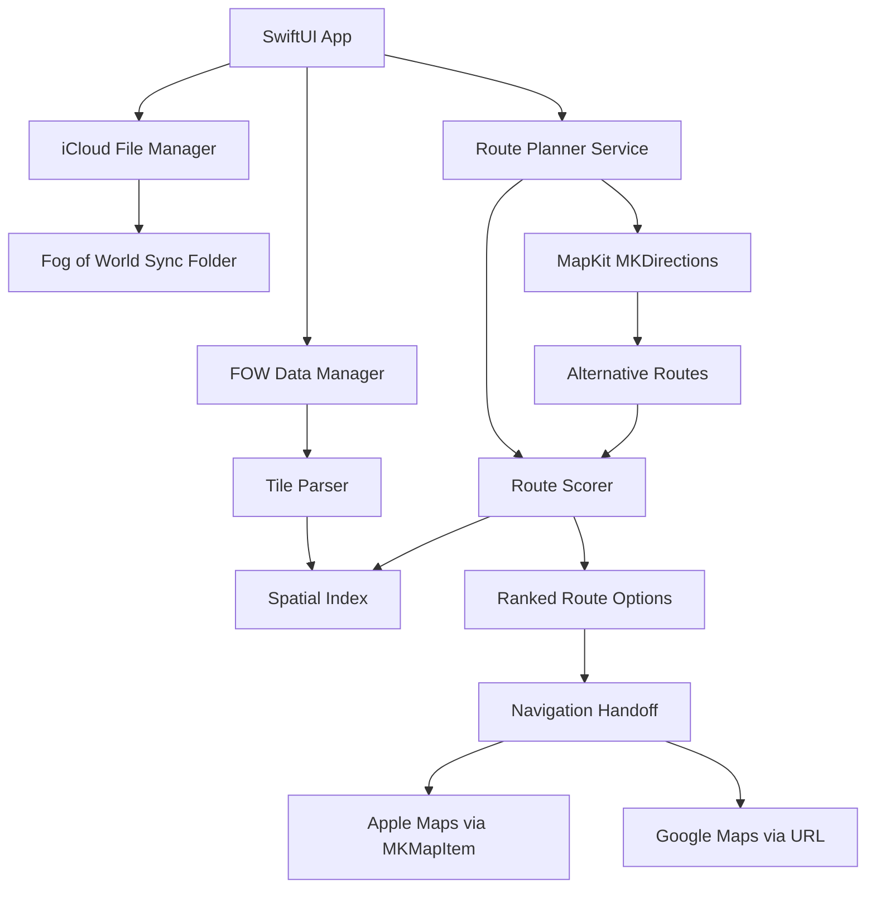

> **Note:** This is the original design plan. Parts of it are out of date; see README.md for how the app works now.

# Novoterra: Fog of World Route Avoidance iOS App

An iOS app that reads Fog of World sync data from iCloud Drive and provides intelligent routing that avoids already-traveled areas, with multiple avoidance intensity levels. **Hands off navigation to Apple Maps or Google Maps.**

## User Review Required

> [!IMPORTANT] > **MapKit Routing Limitation**: Apple's MapKit `MKDirections` does not support custom "avoid areas" natively. The app will request alternative routes and score them based on how much they overlap with traveled areas. This means we can _prefer_ unexplored routes but cannot _guarantee_ complete avoidance.

> [!WARNING] > **iCloud Drive App Folder Access**: Fog of World stores data in its sandboxed App Folder. Users must grant access via document picker, then we persist a security-scoped bookmark for future access.

---

## Architecture Overview



---

## Proposed Changes

### Project Setup

#### [NEW] Novoterra.xcodeproj

- SwiftUI lifecycle, iOS 17.0+
- iCloud capability with "iCloud Documents"
- URL schemes registered for Google Maps detection

---

### Core Data Models

#### [NEW] Models/FOWTile.swift

```swift
struct FOWTile {
    let id: Int
    let x: Int  // 0-511
    let y: Int  // 0-511
    let filename: String
    let blocks: [BlockKey: FOWBlock]
}
```

#### [NEW] Models/FOWBlock.swift

```swift
struct FOWBlock {
    let x: Int  // 0-127 within tile
    let y: Int  // 0-127 within tile
    let bitmap: Data  // 512 bytes = 64x64 bits
    func isVisited(x: Int, y: Int) -> Bool
}
```

#### [NEW] Models/RouteOption.swift

```swift
struct RouteOption: Identifiable {
    let id: UUID
    let route: MKRoute  // Needed for waypoint extraction
    let avoidanceScore: Double
    let avoidanceLevel: AvoidanceLevel
    let newDistanceMeters: Double
    let traveledDistanceMeters: Double
    let keyWaypoints: [CLLocationCoordinate2D]  // Pre-extracted for handoff
}

enum AvoidanceLevel: String, CaseIterable {
    case strict = "Pioneer Mode"
    case strong = "Explorer Mode"
    case moderate = "Adventurer Mode"
    case relaxed = "Traveler Mode"
}

enum NavigationApp: String, CaseIterable {
    case appleMaps = "Apple Maps"
    case googleMaps = "Google Maps"
}
```

---

### Mercator Projection Math (Critical)

#### [NEW] Services/MercatorProjection.swift

> [!CAUTION] > **Precision Critical**: If the math is off by 1 pixel, avoidance logic will be offset by ~70 meters. This is the "physics engine" of the app.

```swift
/// Converts between CLLocationCoordinate2D and FOW tile/block/pixel coordinates
struct MercatorProjection {
    static let MAP_WIDTH = 512        // Tiles at zoom level 9
    static let TILE_WIDTH = 128       // Blocks per tile
    static let BITMAP_WIDTH = 64      // Pixels per block

    /// Convert lat/lng to global pixel coordinates
    static func lngLatToGlobalPixel(lng: Double, lat: Double) -> (x: Int, y: Int) {
        let x = ((lng + 180) / 360) * Double(MAP_WIDTH)
        let latRad = lat * .pi / 180
        let y = ((Double.pi - asinh(tan(latRad))) * Double(MAP_WIDTH)) / (2 * .pi)

        let xg = Int(x * Double(TILE_WIDTH * BITMAP_WIDTH))
        let yg = Int(y * Double(TILE_WIDTH * BITMAP_WIDTH))
        return (xg, yg)
    }

    /// Break down global pixel to tile/block/bit coordinates
    static func globalPixelToComponents(_ gx: Int, _ gy: Int) -> TileBlockPixel {
        let tileX = gx >> 13  // / (128 * 64)
        let tileY = gy >> 13

        let blockX = (gx >> 6) & 0x7F  // / 64, mod 128
        let blockY = (gy >> 6) & 0x7F

        let pixelX = gx & 0x3F  // mod 64
        let pixelY = gy & 0x3F

        return TileBlockPixel(
            tileX: tileX, tileY: tileY,
            blockX: blockX, blockY: blockY,
            pixelX: pixelX, pixelY: pixelY
        )
    }

    /// Convenience: coordinate to full breakdown
    static func coordinateToComponents(_ coord: CLLocationCoordinate2D) -> TileBlockPixel {
        let (gx, gy) = lngLatToGlobalPixel(lng: coord.longitude, lat: coord.latitude)
        return globalPixelToComponents(gx, gy)
    }
}

struct TileBlockPixel {
    let tileX, tileY: Int      // 0-511
    let blockX, blockY: Int    // 0-127
    let pixelX, pixelY: Int    // 0-63

    var tileKey: String { "\(tileX)-\(tileY)" }
    var blockKey: String { "\(blockX)-\(blockY)" }
}
```

---

### FOW Data Parser (Port from fog-machine TypeScript)

#### [NEW] Services/FOWParser.swift

> [!WARNING] > **Threading Critical**: Zlib decompression is CPU-intensive. A 500MB sync folder will freeze the UI if parsed on the main thread. Run ALL parsing inside `Task.detached` or a background `Actor`.

> [!TIP] > **Zlib Specifics**: Swift's native `Data` prefers GZip. FOW uses raw DEFLATE without headers. Use `import Compression` or lightweight `SWCompression` package.

**Key constants:**

```swift
let FILENAME_MASK1 = "olhwjsktri"
let FILENAME_MASK2 = "eizxdwknmo"
let MAP_WIDTH = 512
let TILE_WIDTH = 128
let BITMAP_WIDTH = 64
let TILE_HEADER_SIZE = 128 * 128 * 2
let BLOCK_SIZE = 515
```

**Functions:**

1. `decodeFilename(_ filename: String) -> Int`
2. `decompressTile(_ data: Data) throws -> Data` (raw DEFLATE, **background only**)
3. `parseTile(_ filename: String, _ data: Data) throws -> FOWTile`
4. `parseBlock(_ data: Data, x: Int, y: Int) -> FOWBlock`

#### [NEW] Services/FOWSpatialIndex.swift

> [!CAUTION] > **RAM Explosion Risk**: A power user with 200+ tiles × 8MB each = 1.6GB RAM → instant crash. DO NOT store bitmaps in memory.

**Memory-Optimized Architecture:**

```swift
/// Stores ONLY tile metadata, loads bitmaps on-demand
class FOWSpatialIndex {
    // Sparse storage: only tracks WHICH blocks exist, not their bitmap data
    private var tileMetadata: [TileKey: TileMetadata] = [:]
    private let fileManager: iCloudFileManager

    struct TileMetadata {
        let fileURL: URL
        let existingBlockKeys: Set<BlockKey>  // Just the keys, not the data
    }

    /// Register tile without loading bitmap data
    func registerTile(url: URL, blockKeys: Set<BlockKey>)

    /// JIT load: only reads bitmap when actually checking a coordinate
    func isCoordinateVisited(_ coord: CLLocationCoordinate2D) -> Bool {
        let tileKey = tileKeyFor(coord)
        guard let metadata = tileMetadata[tileKey] else { return false }

        let blockKey = blockKeyFor(coord)
        guard metadata.existingBlockKeys.contains(blockKey) else { return false }

        // JIT: Load ONLY this specific block's bitmap from disk
        let bitmap = loadBlockBitmap(from: metadata.fileURL, blockKey: blockKey)
        return bitmap.isVisited(localX: ..., localY: ...)
    }

    /// Use memory-mapped file access for efficiency
    private func loadBlockBitmap(from url: URL, blockKey: BlockKey) -> FOWBlock {
        // Use Data(contentsOf: url, options: .mappedIfSafe)
        // OS handles paging automatically
    }
}
```

**Key Points:**

- Index startup: Only parse tile headers (32KB each), NOT block bitmaps
- Block existence: Store `Set<BlockKey>` (~1KB per tile) not `[BlockKey: FOWBlock]` (~8MB)
- JIT loading: Load individual block bitmap only when RouteScorer checks that exact coordinate
- Memory mapping: Use `.mappedIfSafe` to let OS handle paging

---

### iCloud Drive Integration

#### [NEW] Services/iCloudFileManager.swift

> [!WARNING] > **Security-Scoped Bookmark Lifecycle**: Must call `startAccessingSecurityScopedResource()` on every app launch before reading files, and `stopAccessing...` in deinit. Works in Simulator but fails silently on device if not handled correctly.

```swift
class iCloudFileManager: ObservableObject {
    @Published var syncFolderURL: URL?
    @Published var isAccessGranted: Bool = false

    private var isAccessingSecurityScope = false

    func requestFolderAccess()  // UIDocumentPickerViewController
    func saveBookmark(for url: URL)  // Security-scoped bookmark
    func restoreBookmark() -> URL?
    func discoverTileFiles() -> [URL]

    /// CRITICAL: Wrap every file read in security scope guards
    func coordinatedRead(url: URL) async throws -> Data {
        guard url.startAccessingSecurityScopedResource() else {
            throw FileAccessError.securityScopeDenied
        }
        defer { url.stopAccessingSecurityScopedResource() }

        // Use memory-mapped access for large files
        return try Data(contentsOf: url, options: .mappedIfSafe)
    }

    deinit {
        if isAccessingSecurityScope, let url = syncFolderURL {
            url.stopAccessingSecurityScopedResource()
        }
    }
}
```

---

### Route Planning Engine

#### [NEW] Services/RoutePlanner.swift

```swift
class RoutePlanner: ObservableObject {
    @Published var routeOptions: [RouteOption] = []

    private let spatialIndex: FOWSpatialIndex
    private let geocoder = CLGeocoder()

    func calculateRoutes(
        from: CLLocationCoordinate2D,
        to: CLLocationCoordinate2D,
        transportType: MKDirectionsTransportType = .automobile
    ) async throws -> [RouteOption]
}
```

**Algorithm (Two-Pass with Waypoint Fuzzing):**

> [!IMPORTANT] > **MapKit Highway Bias Problem**: Apple's routing engine is optimized for efficiency. Even with `requestsAlternateRoutes = true`, it typically returns 3 variations of the same highway. If you've already traveled that highway, all routes will show 95%+ visited.

> [!WARNING] > **MKDirections Rate Limit**: Pass 2 generates 2-4 extra route requests. Add 0.5s delay between requests. Handle `MKError.loadingThrottled` gracefully by falling back to Pass 1 results.

**Pass 1: Standard Alternate Routes**

1. Request routes with `requestsAlternateRoutes = true`
2. Score each route against spatial index
3. If ANY route has <50% visited → include in results

**Pass 2: Waypoint Fuzzing (Triggered if Pass 1 fails)**
If all routes from Pass 1 are >70% visited:

1. Calculate the midpoint between start and end
2. Generate 2-4 "pivot points" perpendicular to the direct line (15-30km offset)
3. For each pivot point, request a new route with 0.5s delay: Start → Pivot → End
4. Score these "forced scenic" routes
5. Merge best results from both passes

> [!NOTE] > **Rerouting Trap**: Nav apps treat waypoints as "stops" and optimize between them. User warning required: "Navigation apps may optimize between waypoints. Your route preview is shown in green — the nav app may deviate slightly."

```swift
/// Generates perpendicular pivot points to force scenic routes
func generatePivotPoints(
    from: CLLocationCoordinate2D,
    to: CLLocationCoordinate2D,
    offsetKm: Double = 20
) -> [CLLocationCoordinate2D] {
    let midpoint = midpointBetween(from, to)
    let bearing = bearingBetween(from, to)

    // Generate points perpendicular to the direct route
    let leftPivot = coordinateOffset(from: midpoint, bearingDegrees: bearing + 90, distanceKm: offsetKm)
    let rightPivot = coordinateOffset(from: midpoint, bearingDegrees: bearing - 90, distanceKm: offsetKm)

    return [leftPivot, rightPivot]
}
```

#### [NEW] Services/RouteAnalyzer.swift

```swift
struct RouteAnalysis {
    let totalDistanceMeters: Double
    let visitedPercentage: Double
    let segments: [RouteSegment]
}
```

#### [NEW] Services/PivotPointGenerator.swift

Handles the geometric calculations for waypoint fuzzing:

- `midpointBetween(_:_:)` — Haversine midpoint
- `bearingBetween(_:_:)` — Initial bearing in degrees
- `coordinateOffset(from:bearingDegrees:distanceKm:)` — Destination point given bearing/distance

---

### Navigation Handoff (NEW SECTION)

#### [NEW] Services/NavigationHandoff.swift

This is the critical service that exports routes to external navigation apps.

```swift
import MapKit
import UIKit

enum NavigationApp: String, CaseIterable, Identifiable {
    case appleMaps = "Apple Maps"
    case googleMaps = "Google Maps"

    var id: String { rawValue }
}

class NavigationHandoff {

    /// Opens the selected navigation app with the route
    static func openRoute(
        in app: NavigationApp,
        route: MKRoute,
        destination: CLLocationCoordinate2D
    ) {
        // Extract high-density waypoints to minimize re-routing through traveled areas
        // More waypoints = less chance of nav app rerouting onto main roads
        let waypoints = extractWaypoints(from: route, maxCount: app.maxWaypoints)

        switch app {
        case .appleMaps:
            openAppleMaps(waypoints: waypoints, destination: destination)
        case .googleMaps:
            openGoogleMaps(waypoints: waypoints, destination: destination)
        }
    }

    // MARK: - Apple Maps (Official API - Reliable)

    private static func openAppleMaps(
        waypoints: [CLLocationCoordinate2D],
        waypointNames: [String?],  // Pre-fetched in background, may be nil
        destination: CLLocationCoordinate2D
    ) {
        // Convert coordinates to MKMapItems
        // NOTE: Reverse geocoding is ASYNC - names must be pre-fetched while user views RouteCard
        // If not ready, fall back to "Checkpoint X" (reliable and fast)
        var mapItems: [MKMapItem] = waypoints.enumerated().map { index, coord in
            let placemark = MKPlacemark(coordinate: coord)
            let item = MKMapItem(placemark: placemark)
            item.name = waypointNames[safe: index] ?? "Checkpoint \(index + 1)"
            return item
        }

        // Add final destination
        let destPlacemark = MKPlacemark(coordinate: destination)
        let destItem = MKMapItem(placemark: destPlacemark)
        destItem.name = "Destination"
        mapItems.append(destItem)

        // Launch options
        let launchOptions: [String: Any] = [
            MKLaunchOptionsDirectionsModeKey: MKLaunchOptionsDirectionsModeDriving
        ]

        // Open Apple Maps with multi-stop route
        MKMapItem.openMaps(with: mapItems, launchOptions: launchOptions)
    }

    // MARK: - Google Maps (Universal Link)

    private static func openGoogleMaps(
        waypoints: [CLLocationCoordinate2D],
        origin: CLLocationCoordinate2D,
        destination: CLLocationCoordinate2D
    ) {
        // Use URLComponents for clean, safe URL construction
        // Docs: https://developers.google.com/maps/documentation/urls/get-started
        var components = URLComponents(string: "https://www.google.com/maps/dir/")!

        let waypointString = waypoints
            .map { "\($0.latitude),\($0.longitude)" }
            .joined(separator: "|")

        components.queryItems = [
            URLQueryItem(name: "api", value: "1"),
            URLQueryItem(name: "origin", value: "\(origin.latitude),\(origin.longitude)"),
            URLQueryItem(name: "destination", value: "\(destination.latitude),\(destination.longitude)"),
            URLQueryItem(name: "waypoints", value: waypointString),
            URLQueryItem(name: "travelmode", value: "driving")
        ]

        guard let url = components.url else { return }

        // Universal Link handles app-or-web decision automatically
        UIApplication.shared.open(url)
    }


    // MARK: - Waypoint Extraction

    /// Extracts key waypoints from route polyline
    /// Uses high density to minimize navigation app re-routing through main roads
    private static func extractWaypoints(from route: MKRoute, maxCount: Int) -> [CLLocationCoordinate2D] {
        let polyline = route.polyline
        let pointCount = polyline.pointCount

        guard pointCount > 2 else { return [] }

        // Get all coordinates
        var coordinates = [CLLocationCoordinate2D](repeating: CLLocationCoordinate2D(), count: pointCount)
        polyline.getCoordinates(&coordinates, range: NSRange(location: 0, length: pointCount))

        // Don't include first (current location) or last (destination)
        let intermediate = Array(coordinates.dropFirst().dropLast())

        guard intermediate.count > maxCount else { return intermediate }

        // Evenly distribute waypoints along route
        var result: [CLLocationCoordinate2D] = []
        let step = Double(intermediate.count) / Double(maxCount)

        for i in 0..<maxCount {
            let index = Int(Double(i) * step)
            result.append(intermediate[index])
        }

        return result
    }
}

extension NavigationApp {
    /// Maximum waypoints each app supports
    var maxWaypoints: Int {
        switch self {
        case .appleMaps: return 15  // MKMapItem handles well
        case .googleMaps: return 9   // URL length limits
        }
    }
}
```

---

### SwiftUI Views

#### [NEW] Views/RoutePlannerView.swift

- Search bar for destination
- Current location display
- Avoidance level picker
- "Find Routes" button
- Results list with route cards

#### [NEW] Views/RouteCardView.swift

```swift
struct RouteCardView: View {
    let routeOption: RouteOption
    @State private var showingAppPicker = false

    var body: some View {
        VStack {
            // Route summary (distance, ETA, new territory %)
            HStack {
                Text("🌟 \(Int((1 - routeOption.avoidanceScore) * 100))% New Territory!")
                Spacer()
                Text(formatDistance(routeOption.route.distance))
            }

            // "Start Navigation" button
            Button("Start Navigation") {
                showingAppPicker = true
            }
            .confirmationDialog("Choose Navigation App", isPresented: $showingAppPicker) {
                Button("Apple Maps (Recommended)") {
                    NavigationHandoff.openRoute(in: .appleMaps, route: routeOption.route, destination: destination)
                }
                Button("Google Maps") {
                    NavigationHandoff.openRoute(in: .googleMaps, route: routeOption.route, destination: destination)
                }
            }
        }
    }
}
```

#### [NEW] Views/RouteMapView.swift

- User location + destination markers
- Route polylines (green = new, red = visited)
- Selected route highlighted

#### [NEW] Views/SettingsView.swift

- iCloud folder access management
- Default navigation app preference
- Clear cache option

---

## Avoidance Level Naming

| Level | Name                | Description                          | Threshold     |
| ----- | ------------------- | ------------------------------------ | ------------- |
| 1     | **Pioneer Mode**    | "Chart new territory"                | <10% traveled |
| 2     | **Explorer Mode**   | "Venture into the unknown"           | <30% traveled |
| 3     | **Adventurer Mode** | "Balance exploration and efficiency" | <50% traveled |
| 4     | **Traveler Mode**   | "Just show me the options"           | All routes    |

---

## Verification Plan

### Unit Tests

1. `testFilenameDecoding` - Tile ID extraction
2. `testZlibDecompression` - Sample tile data
3. `testBlockBitmapReading` - `isVisited(x:y:)`
4. `testCoordinateConversion` - Mercator projection
5. `testWaypointExtraction` - Verify even distribution

### Manual Testing

1. **Parser**: Compare tile count with fog-machine web tool
2. **Routing**: Verify avoidance scores match visual inspection
3. **Apple Maps Handoff**: Confirm waypoints appear as stops
4. **Google Maps Handoff**: Verify route follows waypoints

---

## Performance Notes

- Lazy tile loading (viewport + buffer)
- Quadtree spatial index for O(log n) lookups
- LRU cache for parsed tiles
- Background thread parsing
