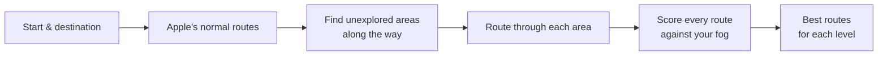

<div align="center">


# NovoTerra

**Go somewhere new on the way to somewhere you know.**

NovoTerra reads your [Fog of World](https://fogofworld.app) history and plans routes through the roads and paths you haven't travelled yet.


</div>

---

## What it does

Fog of World records everywhere you go and covers the rest of the map in fog. NovoTerra turns that record into a planning tool. Pick a destination and it finds routes that clear the most fog, without turning a 20-minute trip into a 2-hour one.

1. **Connect your data.** Point NovoTerra at your Fog of World folder in iCloud Drive. It copies the tiles locally and keeps them in sync.
2. **Choose where you're going.** Search for a place, then pick drive, cycle or walk.
3. **Pick how adventurous to be.** Each level allows a little more extra time than the fastest route.
4. **Go.** Open the route in Apple Maps or Google Maps. NovoTerra adds stops along the way, so the navigation app follows the unexplored route rather than the usual one.

## Features

| | |
| --- | --- |
| 🧭 **Exploration routing** | Ranks routes by how much new ground they cover. |
| 🎚️ **Three levels** | **Balanced** allows up to 20% more time than the fastest route. **Adventurous** allows up to 50%, and **Exploration** up to 100%. |
| 🚗 🚲 🚶 **Drive, cycle or walk** | Planning and navigation both use the travel mode you choose. |
| 🌫️ **Fog overlay** | The map is fogged everywhere except where your tracks have been. |
| ⏱️ **Compared with the fastest route** | Each route card shows the extra time and extra new distance, for example "+6 min · +3.1 km new". |
| 🚧 **Avoid tolls or motorways** | Optional for driving routes. |
| 📲 **Navigation handoff** | Opens the route in Apple Maps or Google Maps, with stops along it. |
| 🔒 **Private by design** | Your location history stays on your device. NovoTerra has no account, server or analytics. |

## How routing works

MapKit can find routes, but it can't be told to avoid areas, so NovoTerra steers it.



1. **Baseline.** NovoTerra asks MapKit for its normal routes. The fastest one sets the time budget for each level.
2. **Find unexplored areas.** It probes a grid of points across the corridor between start and destination. It keeps the most unexplored points that are well spread out.
3. **Detour.** It asks for a two-leg route through each point, a few at a time to stay under MapKit's rate limit. Routes that double back on themselves are rejected.
4. **Score.** It samples every route each 20 m and checks each sample against your fog data. A sample counts as visited if one of your tracks is within 20 m, which absorbs GPS noise.
5. **Rank.** It removes near-duplicate routes. Each level then shows its best three routes within its time budget.

### Navigation handoff limits

- **Apple Maps** follows the stops NovoTerra adds. It doesn't accept avoid-tolls or avoid-motorways from other apps. Between stops it uses your own settings in **Settings > Apps > Maps**.
- **Google Maps** follows up to 9 stops and keeps the avoid preferences. If the Google Maps app isn't installed, the route opens in a browser, and Google allows only 3 stops there.

## Getting started

### Requirements

- iPhone with iOS 17 or later
- Xcode 26 or later (the app icon uses Icon Composer)
- [XcodeGen](https://github.com/yonaskolb/XcodeGen): `brew install xcodegen`
- Fog of World with iCloud sync turned on

### Build and run

```bash
git clone https://github.com/AlexMorrissey-Smith/NovoTerra.git
```

```bash
cd NovoTerra && xcodegen generate
```

```bash
open NovoTerra.xcodeproj
```

Then in Xcode:

1. Select the **NovoTerra** target, open **Signing & Capabilities**, and choose your team.
2. Run the app on your iPhone.
3. In the app, tap **Connect Fog of World data** and choose your Fog of World folder in iCloud Drive. Choosing the parent folder also works; NovoTerra finds the `Sync` folder inside it.

`project.yml` is the source of truth for the Xcode project. Edit it, not the generated `.xcodeproj`, then run `xcodegen generate` again.

## Tests

The `NovoTerraTests` target holds logic tests for the parser, the spatial index, the fog renderer and the route geometry.

```bash
xcodebuild test -project NovoTerra.xcodeproj -scheme Novoterra -destination 'platform=iOS Simulator,name=iPhone 17'
```

The Fog of World tests need real sync files as fixtures. Those files are personal location history, so they aren't in the repository: `FOW File Examples/` is gitignored. To run those tests, do one of these:

- Copy some tile files from your own Fog of World `Sync` folder into `FOW File Examples/`.
- Set `FOW_FIXTURES_DIR` to a folder that holds them.

Without fixtures, those tests are skipped.

## Architecture

```
Novoterra/
├── App/          Entry point, launch load and foreground refresh
├── Models/       Tiles, routes, travel modes and exploration levels
├── Services/     Data pipeline, routing, fog rendering and handoff
└── Views/        SwiftUI screens: planner, search, route cards, settings
```

| Component | Role |
| --- | --- |
| `FOWParser` | Decodes tile filenames and decompresses tile files. |
| `MercatorProjection` | Converts between coordinates and Fog of World tile, block and pixel space. |
| `FOWSpatialIndex` | Actor that holds the tile list, a size-limited cache of decoded tiles, and the visited checks. |
| `FOWDataManager` | Syncs the iCloud folder into a local cache, builds the index, and refreshes when the app returns to the foreground. |
| `LocalFileCache` | Copies tile files from iCloud Drive into the app's sandbox and starts iCloud downloads. |
| `RoutePlanner` | Generates, scores and ranks candidate routes. |
| `FogTileOverlay` / `FogRenderer` | Draws the fog as map tiles. |
| `NavigationHandoff` | Opens Apple Maps or Google Maps with the route's stops. |

## Acknowledgements

- The Fog of World file format is based on [fog-machine](https://github.com/CaviarChen/fog-machine) by CaviarChen.
- NovoTerra is an independent project. It isn't affiliated with or endorsed by Fog of World.

## License

[MIT](LICENSE) © Alex Morrissey-Smith
